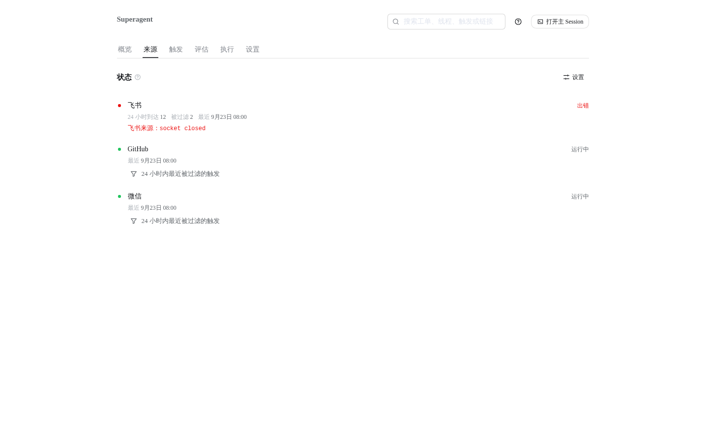
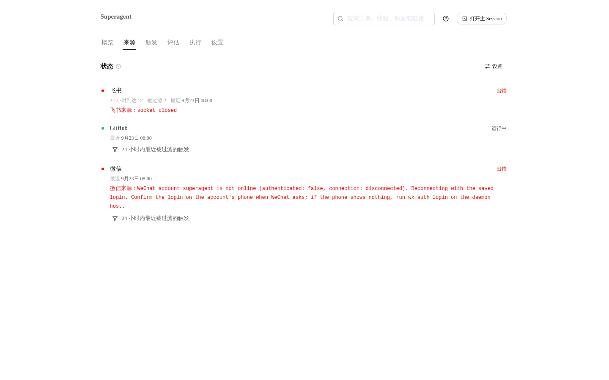

# WeChat Source heartbeats: before/after UI evidence

Both captures are 1440×900, light theme, Chinese UI, and render the panel from the repository's own
client components, stylesheet and DSH design tokens. The server data is the panel test fixture
(`tests/fixtures/panel-server.ts`), extended with a WeChat Source. The two revisions use the same
fixture except for the health entry the revision's Source loop reports for the same scenario: the
WeChat account is disconnected while the daemon's message watch process stays alive.

The baseline image is the actual panel client at `fdd6e39`, this branch's base; the after image is
the actual panel client at this PR's head. No client code changes in this PR, so the visible
difference is the WeChat health entry and its detail, exactly as the Source now reports it. The detail
shown in the after capture is the literal string the new `heartbeat` sends for that state.

A live capture was not taken: signing the deployment's real WeChat account out would stop the Source
this service runs on.

## Source status

Same Source page with the WeChat account disconnected while its watcher stays up.

| Before (`fdd6e39`) | After (this PR) |
| --- | --- |
|  |  |

- Before: the `wechat` entry stays `ready` ("运行中"), because the consumer only reported health when
  it started or when the watch process exited; nothing said that WeChat messages stopped arriving.
- After: the heartbeat reports `error` ("出错") with the account, `authenticated: false`,
  `connection: disconnected`, and the phone-confirmation fix. `scripts/dsh-superagent status` exits 2
  with the same detail, and returns to 0 after the account is online again.

## Reproduction

The generator is intentionally not committed. It mounted the real `App` from
`tests/fixtures/panel.tsx` in jsdom with the route set to `source`, serialized the DOM with
`src/client/client.css` and the DSH theme tokens, and rendered the result in headless Chrome at
1440×900. The baseline worktree was checked out at `fdd6e39`; the after worktree is this PR's head.
