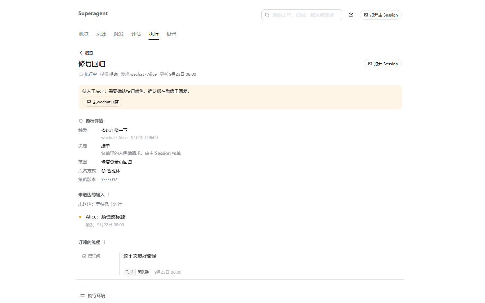
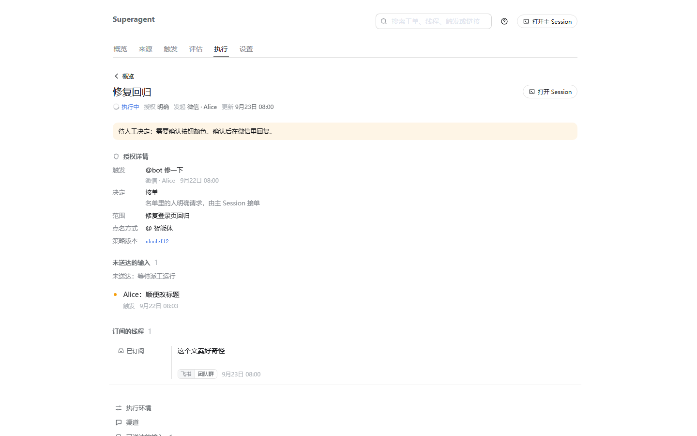
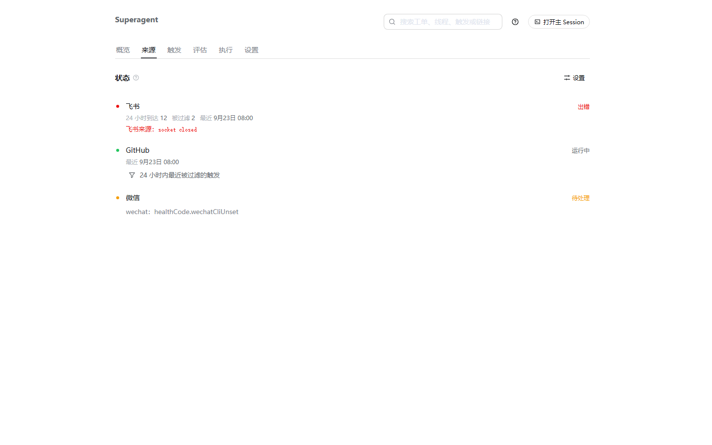
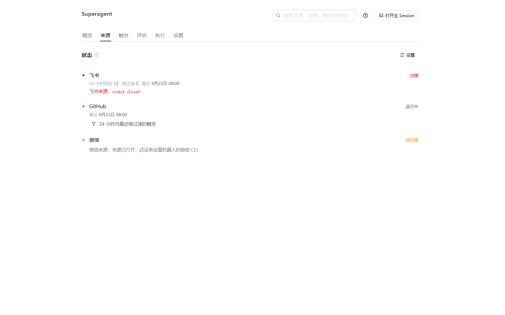

# WeChat Source: before/after UI evidence

Both captures are 1440×900, light theme, Chinese UI, and render the panel from the repository's own
client components, stylesheet and DSH design tokens. The server data is the panel test fixture
(`tests/fixtures/panel-server.ts`), extended with a WeChat source/channel; the two revisions use
exactly the same data. These are not mockups of the previous implementation: the baseline images are
the actual client at `8c32a9d`, and the after images are the actual client at this PR's head.

A live capture would need a signed-in Agent WeChat daemon and a configured deployment, which this
ticket's environment does not have.

## Ticket attention banner

Same ticket page (`execution/t1`) with a blocked question and a WeChat channel whose address has no
web URL.

| Before (`8c32a9d`) | After (this PR) |
| --- | --- |
|  |  |

- Before: the source name is the raw `wechat`, and the banner shows a dead "去wechat回答" link whose
  `href` is empty.
- After: the source name is 微信, and the banner shows no answer link because the channel has no URL.

## Source status

Same Source page with a WeChat source whose `wechat` health entry is paused with code
`wechatCliUnset`.

| Before (`8c32a9d`) | After (this PR) |
| --- | --- |
|  |  |

- Before: `wechat: healthCode.wechatCliUnset`, with the untranslated key.
- After: `微信来源: 来源已打开，还没有设置机器人的微信 CLI`, with the health entry name and code
  localized.

## Reproduction

The generator is intentionally not committed. It mounted the real `App` from
`tests/fixtures/panel.tsx` in jsdom, set the route through the panel's `sessionStorage` location,
serialized the DOM together with `src/client/client.css` and the DSH theme tokens, and rendered the
result in headless Chrome at 1440×900. The baseline worktree was checked out at `8c32a9d`; the after
worktree is this PR's head. No source code other than the two evidence commits differs between the
captures.
